<div align="center">



<p align="center">
  
</p>

[](mailto:xiangyang.1a2@gmail.com)


<p align="center">
  <picture>
    <source media="(prefers-color-scheme: dark)" srcset="https://raw.githubusercontent.com/axewhy-xy/axewhy-xy/output/pacman-contribution-graph-dark.svg" />
    <source media="(prefers-color-scheme: light)" srcset="https://raw.githubusercontent.com/axewhy-xy/axewhy-xy/output/pacman-contribution-graph.svg" />
    
  </picture>
</p>

</div>

---

```
class Lau Xiang Yang {
public:
    static const std::string role         = "Software Engineer";
    static const std::string builds       = "Computer Vision and Machine Learning";

    std::vector<std::string> projects = {
        "Formula 9: Autonomous Shuttle Fleet Training Simulator",
        "HDB Feature Detection for Wolbachia Release Planning",
        "Illegal Fishing Detection"
    };

    std::vector<std::string> interests = {
        "LLMs",
        "Computer Vision",
        "Machine Learning"
    };

private:
    std::vector<std::string> hobbies = {
        "Traveling",
        "Reading"
    };
}
```

I turn real-world images into useful data. My work sits where **computer vision**, **machine learning**
and **simulation** meet: I build detection datasets from scratch, train object detectors on them, and
engineer simulation software that prepares people to operate autonomous vehicles.

## At a glance

- 🔭 **Now:** leading development of **Formula 9**, an autonomous-shuttle fleet training simulator, in a team of 8
- 🎓 **Education:** B.S. Computer Science in Interactive Media and Game Development, **DigiPen Singapore** (Class of 2028)
- 🔌 **Previously:** Diploma in Electronic & Computer Engineering, **Ngee Ann Polytechnic**
- 💼 **Experience:** computer-vision internships at the **National Environment Agency** and the **National Parks Board**

## Featured work

### 🏢 HDB Feature Detection for *Wolbachia* Release Planning

<sub><b>National Environment Agency (NEA) &nbsp;·&nbsp; Internship &nbsp;·&nbsp; Apr – Aug 2026</b></sub>

An end-to-end computer-vision pipeline that detects building features linked to mosquito breeding in
imagery of Singapore's HDB blocks, helping researchers plan *Wolbachia-Aedes* mosquito releases.

<table>
  <tr>
    <td align="center"><b>~13.7k</b><br><sub>labelled images</sub></td>
    <td align="center"><b>~80k</b><br><sub>bounding boxes</sub></td>
    <td align="center"><b>5</b><br><sub>feature classes</sub></td>
    <td align="center"><b>2</b><br><sub>imagery sources</sub></td>
  </tr>
</table>

- **Dataset from scratch:** geocoded postal codes with the **OneMap API**, then pulled satellite tiles and
  Street View images through the **Google Maps APIs** with reproducible train / validation / test splits
- **Data integrity:** wrote augmentation and leak-checking tools so near-identical images never appear in
  both training and test sets, plus scripts that keep dataset metadata in sync
- **Modelling:** fine-tuned a **Faster R-CNN (ResNet-50 FPN v2)** detector in **PyTorch** with mixed-precision
  training, per-class precision / recall / F1 / mAP, early stopping, LR scheduling and crash-safe checkpointing
- **Delivery:** ran inference on unlabelled imagery and exported predictions as COCO JSON and CSV for the
  research team

Detected classes: solar panels, water tanks, laundry drying fixtures, and concrete and frame air-conditioner mounts.

**Stack:** `Python` `PyTorch` `torchvision` `Faster R-CNN` `Google Maps API` `OneMap API` `Label Studio` `COCO`

---

### 🎣 Illegal Fishing Detection

<sub><b>National Parks Board (NParks) &nbsp;·&nbsp; Internship &nbsp;·&nbsp; 2020 – 2021</b></sub>

A real-time detector that spots illegal fishing in park waters, built for an NParks patrol robot so that
staff no longer need to monitor hundreds of parks by hand. No suitable dataset existed, so I built one.

<table>
  <tr>
    <td align="center"><b>30–40 FPS</b><br><sub>real-time on video</sub></td>
    <td align="center"><b>&gt; 0.8</b><br><sub>mAP@0.5</sub></td>
    <td align="center"><b>15–20×</b><br><sub>faster than baseline</sub></td>
  </tr>
</table>

- **Data collection:** wrote a **Selenium** scraper, curated ~600 scraped images down to ~400 usable ones,
  then labelled, augmented and converted them to YOLO format
- **Model comparison:** benchmarked a **Keras YOLOv3** baseline (~2 FPS) against a tuned **YOLOv5** model
  that reached 30–40 FPS with mAP@0.5 above 0.8
- **Experimentation:** ran hyperparameter-tuning and focal-loss experiments, and validated on
  self-recorded footage as a real-world test set

**Stack:** `Python` `PyTorch` `YOLOv5` `Keras` `Selenium`

---

### 🚐 Formula 9: Autonomous Shuttle Fleet Training Simulator

<sub><b>Team project (8 developers) &nbsp;·&nbsp; Technical Lead &nbsp;·&nbsp; 2026 &nbsp;·&nbsp; In progress</b></sub>

A training simulator in which operators run a fleet of autonomous shuttles on real Singapore streets,
handling incidents, detours and charging in real time. A **Unity** client talks to a **Python / FastAPI**
simulation backend through versioned, schema-validated contracts, and the whole system ships as a
one-click Windows build.

- **Leadership:** own the repository and its architecture; authored 50+ commits and reviewed and merged
  35+ pull requests from teammates
- **Traffic simulation:** built backend-driven city traffic in which shuttles and background vehicles obey
  simulated traffic signals, with streamed playback and checkpoint-and-recover for live sessions
- **Real-world road data:** introduced an **OpenStreetMap**-backed road network with turn validation and
  waypoint planning, and a reproducible importer that populates traffic from **LTA** data
- **Training scenarios:** designed randomised incident placement, per-shuttle incident decisions, and an
  interactive route-planning and live-detour workflow
- **3D city:** rendered the road network, cut building meshes around transit routes, and smoothed
  shuttle motion between server snapshots
- **Shipping:** wrote the build pipeline that bundles the Unity player with a portable Python backend,
  including lifecycle management so every open client shares one backend that shuts down cleanly

**Stack:** `C#` `Unity` `Python` `FastAPI` `MongoDB` `SQLite` `JSON Schema` `OpenStreetMap`


## Tech stack

| Area | Tools |
| :--- | :--- |
| **Languages** |     |
| **ML & Computer Vision** |     |
| **Simulation & Backend** |     |
| **Data & Geospatial** |    |
| **Tooling** |   |

## Get in touch

I'm always happy to talk about computer vision, simulation, or internship and graduate opportunities.
Reach me at **[xiangyang.1a2@gmail.com](mailto:xiangyang.1a2@gmail.com)**.
